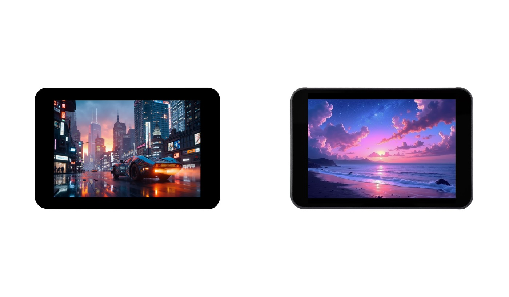

  <h1>ESP32-S3-Touch-LCD-3.5B</h1>
  
<strong>ESP32-S3 3.5-inch 320 × 480 QSPI capacitive touch LCD development board</strong>

  
<a href="README.md">English</a> | <a href="README_ZH.md">简体中文</a>

  

    
    
    
  

  

    <a href="https://www.waveshare.net/shop/ESP32-S3-Touch-LCD-3.5B.htm">🌐 Product</a> &middot;
    <a href="#quick-start">📦 Firmware</a> &middot;
    <a href="examples/esp-idf/">🧩 ESP-IDF</a> &middot;
    <a href="examples/arduino/examples/">🔧 Arduino</a> &middot;
    <a href="https://docs.waveshare.net/ESP32-S3-Touch-LCD-3.5B/">📚 Documentation</a>
  

  

  
Left: without enclosure. Right: with enclosure and OV5640 camera.

---

## ✨ Overview

Two versions share the ESP32-S3 platform and the examples in this repository. Select peripherals according to the hardware fitted to your unit.

| Model | Enclosure | Camera |
| --- | --- | --- |
| [ESP32-S3-Touch-LCD-3.5B](https://www.waveshare.net/shop/ESP32-S3-Touch-LCD-3.5B.htm) | Not included | Connector provided; camera not included by default |
| [ESP32-S3-Touch-LCD-3.5B-C](https://www.waveshare.net/shop/ESP32-S3-Touch-LCD-3.5B-C.htm) | Included | OV5640 included |

| Item | Specification |
| --- | --- |
| MCU / wireless | ESP32-S3; 2.4 GHz Wi-Fi and Bluetooth LE |
| Flash / PSRAM | 16 MB Flash / 8 MB PSRAM |
| Display / touch | 3.5-inch 320 × 480 LCD; AXS15231B; QSPI display and I2C capacitive touch |
| Power management | AXP2101 |
| Motion / clock | QMI8658 IMU / PCF85063 RTC |
| Audio | ES8311 codec, microphone and speaker interface |
| Expansion | microSD, camera connector, TCA9554 I/O expander, USB-C |

PCB V1/V2 schematic revisions are separate from the enclosure options.

## 📦 Quick Start

1. Connect the board to a computer using a USB-C data cable.
2. Download the [factory image with Xiaozhi](firmware/ESP32-S3-Touch-LCD-3.5B_XiaoZhi_20261020.bin) and select ESP32-S3 in Flash Download Tool.
3. Flash the merged image at `0x0`. If download mode is required, hold BOOT, press RESET, then release BOOT.
4. Open the serial monitor at 115200 baud and check the expected result.

Factory firmware source: [examples/factory](examples/factory/), with the application desktop and Xiaozhi voice chat. The [legacy factory example](examples/esp-idf/01_factory/) is also retained. Build the source or obtain the official firmware from the [product documentation](https://docs.waveshare.net/ESP32-S3-Touch-LCD-3.5B/).

## 🧪 Examples

### ESP-IDF

| Example | Function |
| --- | --- |
| [01_factory](examples/esp-idf/01_factory/) | Legacy factory drawing/touch test and applications |
| [02_qmi8658_example](examples/esp-idf/02_qmi8658_example/) | QMI8658 IMU |
| [03_pcf85063_example](examples/esp-idf/03_pcf85063_example/) | PCF85063 RTC |
| [04_axp2101_example](examples/esp-idf/04_axp2101_example/) | AXP2101 power management |
| [05_lvgl_example](examples/esp-idf/05_lvgl_example/) | LVGL widgets |
| [06_lvgl_image](examples/esp-idf/06_lvgl_image/) | Built-in image gallery |
| [07_lvgl_image_sd](examples/esp-idf/07_lvgl_image_sd/) | microSD image gallery |

### Arduino

| Example | Function |
| --- | --- |
| [01_i2s_audio](examples/arduino/examples/01_i2s_audio/) | microSD audio playback |
| [02_axp2101_example](examples/arduino/examples/02_axp2101_example/) | AXP2101 power management |
| [03_button_example](examples/arduino/examples/03_button_example/) | BOOT button |
| [04_es8311_example](examples/arduino/examples/04_es8311_example/) | Microphone recording and playback |
| [05_pcf85063_example](examples/arduino/examples/05_pcf85063_example/) | PCF85063 RTC |
| [06_qmi8658_example](examples/arduino/examples/06_qmi8658_example/) | QMI8658 IMU |
| [07_sd_test](examples/arduino/examples/07_sd_test/) | microSD filesystem |
| [08_gfx_helloworld](examples/arduino/examples/08_gfx_helloworld/) | GFX display |
| [09_lvgl_basic](examples/arduino/examples/09_lvgl_basic/) | LVGL basic display |
| [10_lvgl_arduino_v9](examples/arduino/examples/10_lvgl_arduino_v9/) | LVGL touch controls |
| [11_camera_web_server](examples/arduino/examples/11_camera_web_server/) | Camera web server |

The Arduino examples share one bundled LVGL 9.2.2 library. The ESP-IDF peripheral examples and legacy factory use LVGL 8.4; the current factory uses LVGL 9.6.0~1. Each ESP-IDF project manages its own dependencies.

## 🛠️ Development Environment

| Framework | Version | Examples |
| --- | --- | --- |
| ESP-IDF | v5.5.4 | 7 + factory source |
| Arduino-ESP32 | 3.3.10 | 11 |

Versions and the Arduino board options are defined in [product.json](.github/product.json). Select **ESP32S3 Dev Module**, 16 MB Flash, OPI PSRAM, QIO Flash, USB CDC on boot, and the 16 MB partition scheme with 3 MB application / 9 MB FATFS. Copy the supplied Arduino libraries and shared `lv_conf.h` into your sketchbook's `libraries` directory.

## 📚 Resources

- [Bare board product page](https://www.waveshare.net/shop/ESP32-S3-Touch-LCD-3.5B.htm)
- [Enclosure version product page](https://www.waveshare.net/shop/ESP32-S3-Touch-LCD-3.5B-C.htm)
- [Wiki](https://www.waveshare.com/wiki/ESP32-S3-Touch-LCD-3.5B)
- [V1 schematic](hardware/schematic/ESP32-S3-Touch-LCD-3.5B-V1-Schematic.pdf)
- [V2 schematic](hardware/schematic/ESP32-S3-Touch-LCD-3.5B-V2-Schematic.pdf)

## 🤝 Support

- [GitHub issues](https://github.com/waveshareteam/ESP32-S3-Touch-LCD-3.5B/issues)
- [Waveshare support](https://www.waveshare.com/support/)

## 📄 License

First-party code is provided under [Apache-2.0](LICENSE). Bundled third-party components retain their original licenses and attribution.
